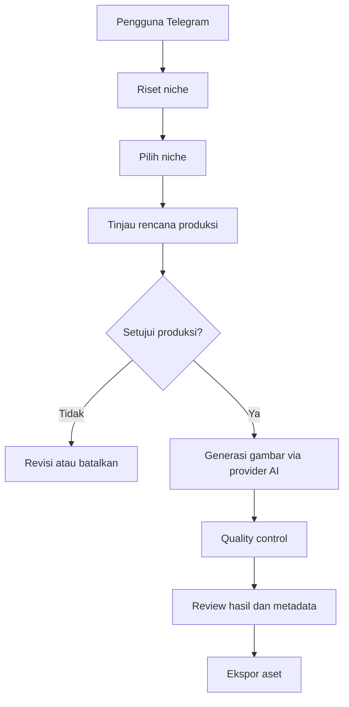

<div align="center">

# RUPIKA
### Rupa, Pikiran, dan Karya

**AI-assisted stock image production, managed through Telegram.**

Riset niche · Perencanaan · Persetujuan · Generasi gambar · Quality control · Metadata · Ekspor

</div>

---

## Tentang RUPIKA

**RUPIKA** adalah proyek bot Telegram untuk membantu alur kerja produksi aset gambar stok komersial. Tujuannya adalah menggabungkan riset niche, penyusunan rencana produksi, pembuatan gambar dengan model AI, pemeriksaan kualitas, dan penyiapan metadata dalam satu workflow yang dapat dipantau.

RUPIKA menggunakan pendekatan **human-in-the-loop**: memilih niche **tidak sama dengan** menyetujui produksi. Operasi yang berpotensi menggunakan API berbayar harus melalui persetujuan eksplisit sesuai konfigurasi dan guardrail yang aktif.

> **Status proyek:** Dalam pengembangan dan pengujian lokal. Ketersediaan fitur serta integrasi API bergantung pada konfigurasi dan implementasi pada versi repository yang digunakan. Jangan menganggap hasil riset `verified` sebagai bukti sumber eksternal tanpa URL atau data pendukung.

## Fitur utama

- **Bot Telegram:** kendali workflow melalui perintah dan tombol interaktif.
- **Riset niche:** menampilkan kandidat niche dan membantu memilih arah produksi.
- **Approval workflow:** pemilihan niche terpisah dari persetujuan generasi gambar.
- **Integrasi AI:** mendukung penggunaan penyedia/model AI melalui adapter yang dikonfigurasi.
- **Quality control:** pemeriksaan kualitas aset dan kelayakan untuk proses berikutnya.
- **Metadata stok:** penyiapan judul, deskripsi, dan keyword sesuai workflow.
- **Ekspor:** penyiapan berkas untuk proses unggah ke platform stok.
- **Monitoring:** status pekerjaan, progres, kegagalan, dan mekanisme retry sesuai fitur yang tersedia.
- **Penyimpanan persisten:** data dan hasil kerja dapat disimpan melalui volume Docker.

> Tidak semua fitur di atas selalu aktif pada setiap deployment. Verifikasi provider, kredensial, model, dan konfigurasi sebelum menjalankan job.

## Cara kerja



**Penting:** memilih niche atau menekan tombol *Select* tidak otomatis memulai generasi gambar. Pastikan persetujuan dan batas biaya sudah benar sebelum memproses job berbayar.

## Persyaratan

Untuk instalasi yang paling praktis:

- Git
- Docker Engine + Docker Compose, atau Docker Desktop
- Akun Telegram dan **token bot** dari [@BotFather](https://t.me/BotFather)
- Kredensial provider AI yang sesuai dengan adapter yang digunakan
- Akses jaringan ke API provider yang dikonfigurasi

Jika memilih instalasi tanpa Docker, ikuti versi Python dan dependency yang ditentukan dalam `pyproject.toml` serta `uv.lock`.

## Instalasi dengan Docker

### 1. Clone repository

```bash
git clone https://github.com/Muhammad-Abid24/RUPIKA-BOT.git
cd RUPIKA-BOT
```

### 2. Siapkan konfigurasi

```bash
cp .env.example .env
```

Buka `.env` dan isi variabel yang **memang didefinisikan dalam `.env.example`**. Periksa khususnya pengaturan:

| Kebutuhan | Yang perlu disiapkan |
| --- | --- |
| Telegram | Token bot dan allowlist Telegram user ID |
| Riset dan pemrosesan teks | Endpoint, API key, dan model yang didukung |
| Generasi gambar | Endpoint, API key, dan model yang benar-benar mendukung output gambar |
| Penyimpanan | Lokasi database dan aset yang sesuai dengan volume |
| Anggaran | Batas biaya dan kebijakan approval sebelum menggunakan API berbayar |

**Jangan menaruh API key atau token asli di GitHub.** Nama variabel yang tepat dapat berubah; gunakan `.env.example` sebagai sumber utama.

### 3. Jalankan service

Repository ini menggunakan `compose.yaml` dan menyediakan `compose.dev.yaml` untuk lingkungan pengembangan.

```bash
docker compose -f compose.yaml -f compose.dev.yaml up -d --build
```

Lihat status container:

```bash
docker compose -f compose.yaml -f compose.dev.yaml ps
```

Lihat log bot:

```bash
docker compose -f compose.yaml -f compose.dev.yaml logs -f bot
```

Jika ingin menghentikan service tanpa menghapus data:

```bash
docker compose -f compose.yaml -f compose.dev.yaml down
```

> Jangan gunakan `down -v` kecuali memang ingin menghapus volume yang digunakan oleh deployment tersebut. File Compose dan nama service dapat berubah antarversi; periksa konfigurasi sebelum menjalankan perintah.

## Mulai menggunakan bot Telegram

1. Cari bot Telegram yang tokennya Anda konfigurasi.
2. Kirim `/start` untuk membuka menu.
3. Kirim `/help` untuk melihat perintah yang tersedia pada versi bot Anda.
4. Gunakan `/research` untuk memulai riset niche.
5. Pilih kandidat niche, lalu **tinjau rencana produksi** sebelum menyetujui penggunaan API berbayar.
6. Pantau proses dan tinjau hasil sebelum mengekspor aset.

### Referensi perintah

Perintah berikut diketahui ada dalam struktur handler proyek, tetapi ketersediaan dan perilakunya perlu diverifikasi pada versi yang Anda jalankan.

| Perintah | Fungsi |
| --- | --- |
| `/start` | Memulai interaksi dan menampilkan menu |
| `/help` | Menampilkan bantuan |
| `/health` | Memeriksa kesehatan layanan |
| `/research` | Memulai riset kandidat niche |
| `/researchmode` | Mengelola mode riset |
| `/researchhistory` | Melihat riwayat riset |
| `/settings` | Melihat atau mengatur opsi bot |
| `/status` | Memantau status pekerjaan |
| `/failed` | Melihat pekerjaan yang gagal |
| `/retry` | Mengulangi pekerjaan yang memenuhi syarat retry |
| `/providers` | Melihat informasi provider |

Contoh penggunaan:

```text
/start
/help
/research
/status
```

## Konfigurasi provider AI

RUPIKA memisahkan kebutuhan pemrosesan teks dan generasi gambar. Endpoint yang kompatibel dengan API chat **belum tentu** mendukung generasi gambar.

Sebelum menjalankan produksi nyata:

1. Pastikan endpoint dan kredensial provider benar.
2. Pilih model yang benar-benar mendukung tugas yang diminta.
3. Pastikan adapter memproses respons provider yang sebenarnya, bukan fixture/mock.
4. Uji dengan job kecil setelah persetujuan dan batas anggaran dikonfigurasi.
5. Verifikasi file hasil secara visual dan teknis, bukan hanya dari keberadaan file di folder output.

**Riset berbasis AI tanpa koneksi ke sumber web atau data pasar tidak boleh diperlakukan sebagai riset pasar terverifikasi.** Untuk label `verified`, sebaiknya tersedia URL sumber, tanggal akses, dan bukti pendukung.

## Penyimpanan dan backup

Dalam konfigurasi Docker yang telah digunakan selama pengembangan, volume bernama `stockforge_data` menyimpan database dan aset. **Jangan menghapus volume tersebut** saat melakukan update biasa.

Sebelum upgrade, backup data menggunakan prosedur pada `deploy/backup.sh` dan baca petunjuk pemulihan di `deploy/restore.sh` serta `deploy/rollback.md` jika tersedia pada revisi repository Anda.

## Troubleshooting

### Bot tidak membalas perintah

Periksa log:

```bash
docker compose -f compose.yaml -f compose.dev.yaml logs --tail=100 bot
```

Jika terlihat **HTTP 409 Conflict**, kemungkinan ada lebih dari satu proses yang menggunakan token bot yang sama untuk `getUpdates`. Pastikan hanya satu instance polling aktif. Status container `healthy` saja tidak menjamin polling Telegram masih berjalan.

### `Query is too old` pada tombol Telegram

Callback query mungkin sudah kedaluwarsa atau dijawab terlambat. Coba gunakan pesan/tombol terbaru, lalu periksa log handler callback. Ini berbeda dari masalah konflik polling.

### File gambar ada, tetapi isinya tidak sesuai

Periksa apakah image adapter memakai provider produksi atau mock/fixture. Validasi format, dimensi, dan isi gambar sebelum menyimpulkan generasi berhasil.

### Provider mengembalikan error

Periksa kredensial, saldo/budget, model ID, endpoint, rate limit, timeout, dan format respons. Jangan menampilkan API key saat membagikan log.

## Keamanan dan penggunaan bertanggung jawab

- Simpan `.env`, token Telegram, dan API key di luar version control.
- Batasi akses bot menggunakan allowlist Telegram ID.
- Gunakan kredensial dengan izin seminimal mungkin.
- Tetapkan batas biaya dan minta persetujuan eksplisit untuk operasi berbayar.
- Periksa hak cipta, merek dagang, privasi, dan kebijakan platform stok sebelum mengunggah aset.
- Jangan menganggap hasil AI otomatis layak dijual atau otomatis diterima Adobe Stock.
- Hindari mengunggah data sensitif ke provider AI tanpa izin.

## Struktur proyek

```text
RUPIKA-BOT/
├── alembic/                     # Migrasi database
│   ├── versions/                # Riwayat revisi migrasi
│   ├── env.py                   # Konfigurasi migrasi
│   └── script.py.mako           # Template migrasi
│
├── config/                      # Konfigurasi workflow
│   ├── models.yaml              # Konfigurasi model AI
│   └── research.yaml            # Konfigurasi riset niche
│
├── deploy/                      # Deployment dan pemulihan
│   ├── backup.sh                # Script backup
│   ├── restore.sh               # Script restore
│   └── rollback.md              # Panduan rollback
│
├── stockforge/                  # Package utama RUPIKA
│   ├── __pycache__/             # Cache Python (lokal)
│   ├── bot/                     # Integrasi Telegram
│   │   ├── __init__.py
│   │   ├── auth.py              # Autentikasi dan izin akses
│   │   ├── handlers.py          # Handler perintah utama
│   │   ├── progress_handlers.py # Handler status progres
│   │   ├── progress.py          # Pembaruan progres
│   │   ├── research_handlers.py # Handler riset niche
│   │   ├── review.py            # Review dan approval
│   │   └── service.py           # Lifecycle Telegram bot
│   │
│   ├── budget/                  # Kontrol anggaran AI
│   ├── db/                      # Database dan model
│   ├── errors/                  # Penanganan error
│   ├── eta/                     # Estimasi waktu proses
│   ├── export/                  # Ekspor aset dan metadata
│   ├── images/                  # Generasi dan pemrosesan gambar
│   ├── ops/                     # Operasional dan healthcheck
│   ├── providers/               # Integrasi provider AI
│   ├── qc/                      # Quality control
│   ├── queue/                   # Antrean pekerjaan
│   ├── research/                # Riset niche
│   ├── storage/                 # Penyimpanan aset
│   ├── __init__.py
│   ├── cli.py                   # Entry point CLI
│   ├── config.py                # Pengaturan aplikasi
│   └── logging.py               # Konfigurasi logging
│
├── .dockerignore                # File yang diabaikan Docker
├── .env.example                 # Template environment
├── .gitignore                   # File yang diabaikan Git
├── AGENT.md                     # Instruksi AI coding agent
├── alembic.ini                  # Konfigurasi Alembic
├── ARCHITECTURE.md              # Dokumentasi arsitektur
├── BACKLOG.md                   # Rencana pengembangan
├── compose.dev.yaml             # Docker Compose development
├── compose.yaml                 # Docker Compose utama
├── Dockerfile                   # Build image Docker
├── KANBAN.md                    # Status pengerjaan
├── pyproject.toml               # Dependency Python
├── README-IMPLEMENTATION.md     # Catatan implementasi
├── README.md                    # Dokumentasi utama GitHub
├── TASK.md                      # Detail pekerjaan
└── uv.lock                      # Lockfile dependency

```

## Kontribusi

Kontribusi, laporan bug, dan usulan fitur dipersilakan melalui [GitHub Issues](https://github.com/Muhammad-Abid24/RUPIKA-BOT/issues). Saat melaporkan masalah, sertakan langkah reproduksi, versi/commit, serta log yang sudah disensor dari token dan kredensial.

Sebelum mengirim pull request, jalankan pengujian yang relevan dan pastikan perubahan tidak menghapus data pengguna atau melewati guardrail persetujuan biaya.

## Lisensi

RUPIKA — Rupa, Pikiran, dan Karya is licensed
under the MIT License.

Copyright (c) 2026 Muhammad Abid.

See the [LICENSE](LICENSE) file for details.

---

<div align="center">

**RUPIKA — Rupa, Pikiran, dan Karya**  
*Dari riset menjadi karya, dengan kontrol tetap di tangan pengguna.*

</div>
